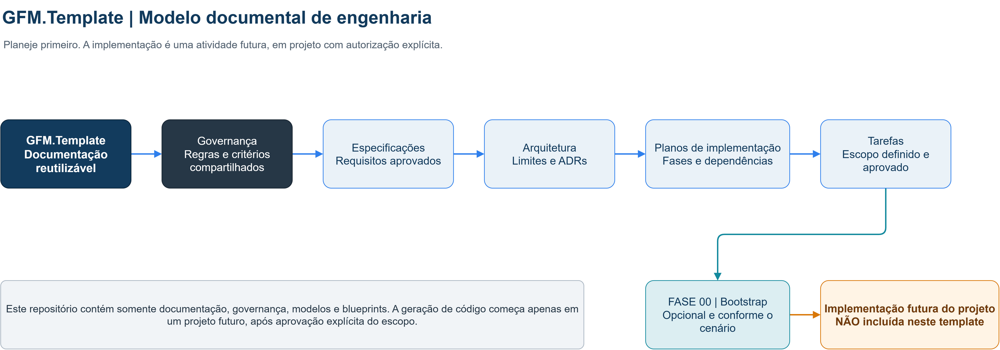
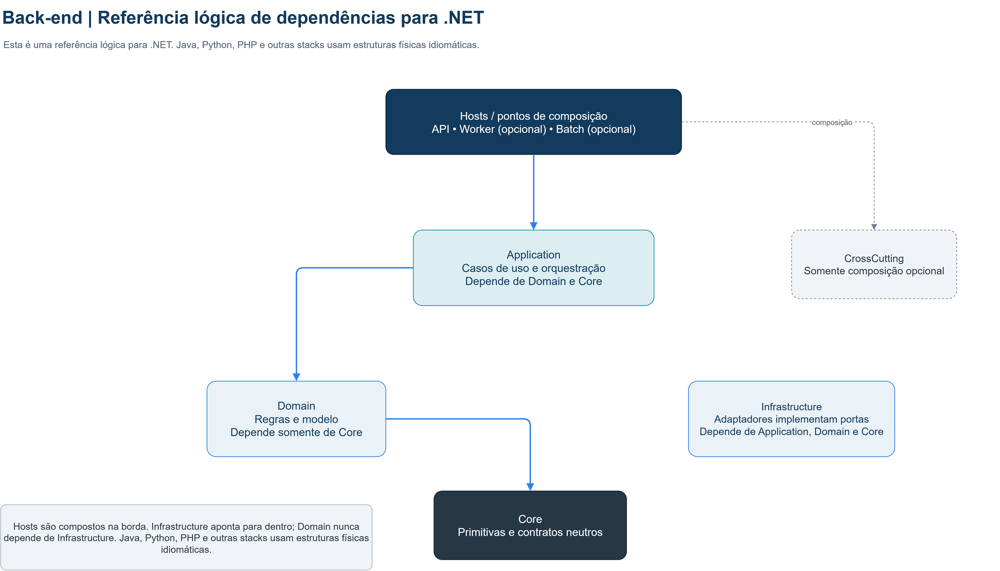
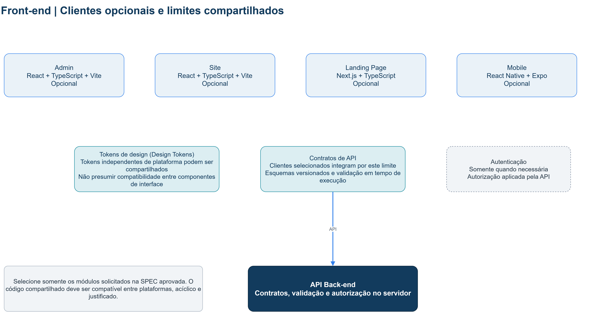
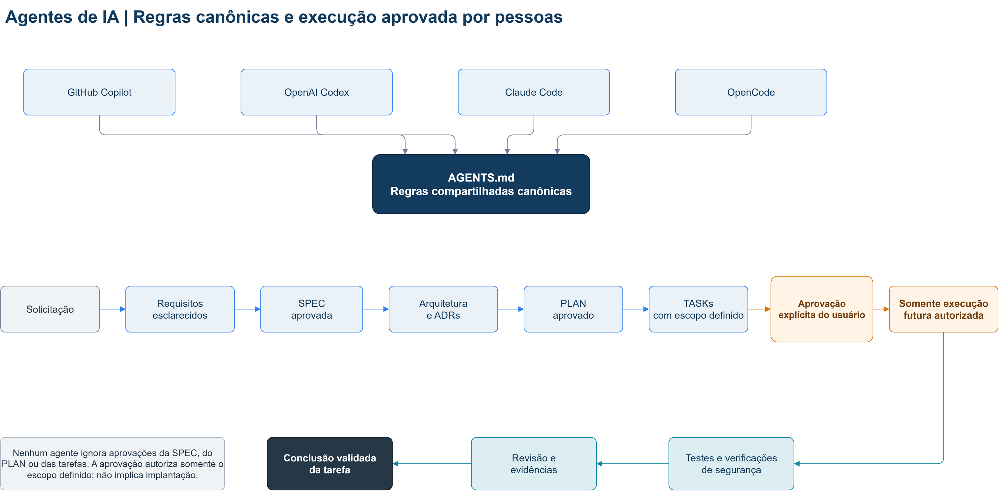
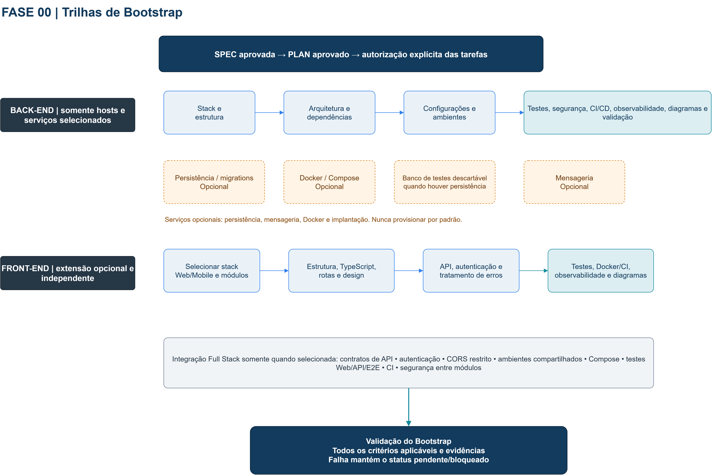
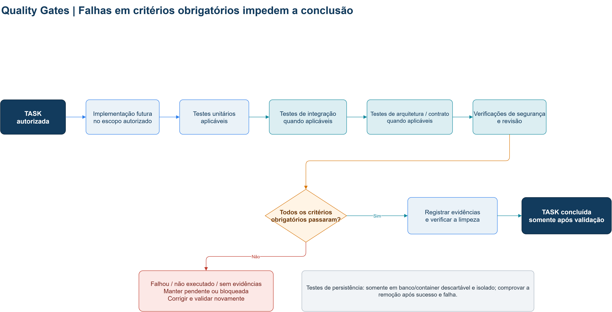
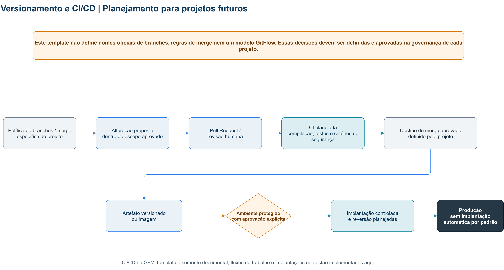

# GFM.Template

**GFM.Template — Arquitetura de Software e Desenvolvimento Orientado por IA**

Base documental, independente de linguagem, para especificar, arquitetar, planejar e orientar a geração futura de projetos de software com apoio de agentes de IA.

> **O GFM.Template não é uma aplicação pronta.** Ele não contém projetos executáveis nem implementa os sistemas descritos. A criação e alteração de código pertencem a projetos futuros, mediante especificação, plano e autorização explícita.

## 1. Visão geral

O repositório reúne governança, padrões, blueprints e modelos rastreáveis para preparar projetos. Parte de princípios comuns — segurança, qualidade, aprovação e documentação — e permite selecionar somente os módulos e tecnologias justificados pelos requisitos de cada iniciativa.

## 2. Objetivos

- Padronizar o caminho entre requisitos e implementação autorizada.
- Reutilizar modelos sem impor uma arquitetura ou stack única.
- Tornar dependências, critérios de qualidade, riscos e decisões explícitos.
- Apoiar o trabalho de diferentes agentes por regras canônicas compartilhadas.
- Manter módulos opcionais e independentes quando o cenário não exigir sua integração.

## 3. Arquitetura geral do template

O conteúdo organiza-se como um fluxo documental: governança e requisitos orientam especificações; especificações aprovadas alimentam arquitetura e planos; planos são decompostos em tarefas; somente tarefas autorizadas podem conduzir a uma **implementação futura**, que não faz parte deste repositório.



## 4. Tecnologias e stacks suportadas

O template é independente de linguagem. A stack deve ser escolhida e aprovada em cada projeto, verificando versões e compatibilidade no momento de sua criação. Os documentos existentes tratam de:

- **Back-end:** .NET/C#, Java, Python, PHP e outras stacks aprovadas; a arquitetura física deve seguir o ecossistema escolhido.
- **Web:** React para Admin e Site; Next.js para Landing Page, conforme o cenário.
- **Mobile:** React Native com Expo, quando necessário.
- **Serviços opcionais:** persistência, mensageria, integrações externas, Docker e publicação, somente quando requisitos aprovados justificarem.

As tecnologias citadas são opções documentais, não dependências instaladas nem compromisso de adoção.

## 5. Módulos Back-end

`src/back-end/` documenta os limites para APIs, Workers, Batch e outros hosts selecionados. Para o cenário .NET, os documentos de arquitetura consideram API, Application, Domain, Core e Infrastructure, com CrossCutting, Worker e Batch opcionais. Não se impõe essa estrutura física a Java, Python, PHP ou outros ecossistemas.

Persistência, mensageria, autenticação e processos hospedados só devem ser incluídos quando necessários. Consulte os [blueprints](blueprints/README.md) e os [modelos Bootstrap Back-end](templates/tasks/bootstrap/back-end/README.md).



## 6. Módulos Admin, Site e Landing Page

Os três módulos Web são cenários distintos e opcionais: **Admin** e **Site** com React, e **Landing Page** com Next.js. Contratos compartilhados e tokens de design (Design Tokens) podem apoiar a consistência sem transformar os módulos em uma única implantação obrigatória.



## 7. Mobile com React Native

O cenário Mobile usa React Native + Expo conforme definido nos documentos de Front-end. É opcional e pode integrar-se ao Back-end por contratos de API; não é pré-requisito para projetos exclusivamente Web ou Back-end.

## 8. Desenvolvimento com agentes de IA

As ferramentas de agente devem seguir as regras compartilhadas em `AGENTS.md`; arquivos específicos de ferramenta servem como pontos de entrada, não como fontes concorrentes de governança. Solicitações, decisões e execução permanecem sujeitas aos mesmos requisitos de escopo e aprovação.



## 9. Fluxo SPEC → ARQUITETURA → PLAN → TASKS

1. Levantar requisitos e registrar a SPEC.
2. Aprovar requisitos antes do planejamento detalhado.
3. Documentar arquitetura, diagramas e ADRs necessários.
4. Criar e aprovar o PLAN com fases e dependências.
5. Decompor o plano em TASKs verificáveis e rastreáveis.
6. Obter autorização explícita antes de executar tarefas que alterem código ou recursos.

A aprovação de um documento não autoriza automaticamente implementação, acesso externo, operações destrutivas ou implantação. O fluxo completo está em [`docs/tasks/agent-workflow.md`](docs/tasks/agent-workflow.md).

## 10. FASE 00 — Bootstrap

A FASE 00 organiza a fundação técnica antes das funcionalidades. Os modelos incluem seleção de stack, estrutura, arquitetura, configurações, testes, segurança, observabilidade, CI/CD, diagramas e validação. Bootstrap Back-end e Front-end são independentes; só são coordenados quando uma SPEC seleciona um projeto Full Stack. Persistência, Docker, mensageria e publicação são condicionais.



Consulte a [SPEC-000](templates/specifications/SPEC-000-fundacao-tecnica.md), o [PLAN-000](templates/implementation-plans/PLAN-000-bootstrap.md), o [Bootstrap Back-end](templates/tasks/bootstrap/back-end/README.md) e o [Bootstrap Front-end](templates/tasks/bootstrap/front-end/README.md). São modelos reutilizáveis, não tarefas de um projeto real.

## 11. Testes e qualidade

Cada projeto futuro define testes e Quality Gates aplicáveis à sua stack e risco. Falhas em gates obrigatórios, validações não executadas ou ausência de evidências impedem a conclusão de uma tarefa. Testes de integração com persistência devem usar recursos temporários e isolados e comprovar limpeza.



As políticas estão em `governance/quality-gates/` e `docs/testing/`.

## 12. Docker e GitHub Actions

`devops/` e `docs/devops/` descrevem o planejamento futuro de ambientes, Docker e GitHub Actions. **Este template não contém Dockerfiles, arquivos Compose executáveis, fluxos de trabalho YAML nem pipelines implementados.** Projetos futuros devem definir seus Quality Gates, artefatos, aprovações, reversão (rollback) e ambientes protegidos antes de automatizar esses processos.



O diagrama não estabelece nomes de branches nem regras oficiais de merge; essas decisões pertencem à governança de cada projeto. A implantação em produção não é automática por padrão.

## 13. Segurança e governança

As regras canônicas e políticas encontram-se em `AGENTS.md`, `governance/` e `docs/security/`. Os princípios incluem menor privilégio, proteção de segredos, registro de logs sem dados sensíveis, revisão de segurança e autorização limitada ao escopo aprovado. Não armazenar segredos no repositório.

## 14. Diagramas de arquitetura

As fontes editáveis Draw.io ficam em `docs/architecture/diagrams/drawio/`; cada PNG abaixo é uma exportação correspondente, derivada da fonte. Mermaid pode complementar diagramas textuais. Diagramas representam uma arquitetura documental e não comprovam que um sistema foi implementado.

| Diagrama | Descrição |
|---|---|
| [Visão geral](docs/architecture/diagrams/gfm-template-overview.png) · [fonte Draw.io](docs/architecture/diagrams/drawio/gfm-template-overview.drawio) | Fluxo documental até a implementação futura, explicitamente fora do template. |
| [Full Stack](docs/architecture/diagrams/gfm-template-fullstack.png) · [fonte Draw.io](docs/architecture/diagrams/drawio/gfm-template-fullstack.drawio) | Back-end, Admin, Site, Landing Page, Mobile e serviços compartilhados ou opcionais. |
| [Back-end](docs/architecture/diagrams/gfm-template-backend.png) · [fonte Draw.io](docs/architecture/diagrams/drawio/gfm-template-backend.drawio) | Camadas lógicas .NET e direção de dependências. |
| [Front-end](docs/architecture/diagrams/gfm-template-frontend.png) · [fonte Draw.io](docs/architecture/diagrams/drawio/gfm-template-frontend.drawio) | Módulos Web/Mobile, contratos, Design Tokens e integração opcional. |
| [Agentes de IA](docs/architecture/diagrams/gfm-template-ai-agents.png) · [fonte Draw.io](docs/architecture/diagrams/drawio/gfm-template-ai-agents.drawio) | Regras canônicas, fluxo documental e aprovação explícita. |
| [Bootstrap](docs/architecture/diagrams/gfm-template-bootstrap.png) · [fonte Draw.io](docs/architecture/diagrams/drawio/gfm-template-bootstrap.drawio) | Trilhas Back-end e Front-end e integração Full Stack opcional. |
| [Quality Gates](docs/architecture/diagrams/gfm-template-quality-gates.png) · [fonte Draw.io](docs/architecture/diagrams/drawio/gfm-template-quality-gates.drawio) | Validações, evidências e bloqueio de conclusão em caso de falha. |
| [Versionamento e CI/CD](docs/architecture/diagrams/gfm-template-gitflow.png) · [fonte Draw.io](docs/architecture/diagrams/drawio/gfm-template-gitflow.drawio) | Capacidade planejada, sem inventar branches ou regras de merge. |

O [índice de arquitetura](docs/architecture/README.md) e o [índice de diagramas](docs/architecture/diagrams/README.md) registram o acervo e suas convenções.

## 15. Estrutura documental

Mapa resumido da estrutura existente — diretórios de implementação são documentais ou reservados, não projetos executáveis:

```text
GFM.Template/
├── AGENTS.md
├── CLAUDE.md
├── .github/copilot-instructions.md
├── .codex/                 # ponto de entrada e orientações do agente
├── .claude/                # ponto de entrada e orientações do agente
├── .opencode/              # ponto de entrada e orientações do agente
├── blueprints/             # cenários Back-end, Front-end e Full Stack
├── devops/                 # planejamento de Docker, ambientes e CI/CD
├── docs/
│   ├── architecture/       # decisões, diagramas e padrões
│   ├── devops/
│   ├── implementation-plans/
│   ├── integration/
│   ├── operations/
│   ├── security/
│   ├── specs/
│   ├── tasks/
│   ├── technical-debt/
│   └── testing/
├── governance/             # agentes, arquitetura, qualidade e segurança
├── src/                    # limites documentais dos módulos futuros
│   ├── back-end/
│   └── front-end/
│       ├── mobile/         # React Native + Expo
│       ├── shared/
│       └── web/
│           ├── admin/      # React
│           ├── site/       # React
│           └── landing-page/ # Next.js
├── templates/              # modelos de SPEC, PLAN, TASK e revisão
│   ├── README.md
│   ├── architecture-decisions/
│   ├── implementation-plans/
│   ├── security-reviews/
│   ├── specifications/
│   ├── tasks/
│   │   ├── bootstrap/
│   │   │   ├── back-end/
│   │   │   └── front-end/
│   │   └── task-template.md
│   ├── test-plans/
└── tests/                  # reservado; sem código nesta fase
```

Consulte os índices de cada pasta para os arquivos e modelos disponíveis. A árvore não pretende enumerar cada documento.

## 16. Como utilizar o template

1. Leia `AGENTS.md`, a governança pertinente e [`docs/tasks/agent-workflow.md`](docs/tasks/agent-workflow.md).
2. Registre objetivo, restrições e requisitos em modelos de `templates/`.
3. Selecione somente stack, blueprint e módulos adequados.
4. Obtenha aprovação da SPEC, da arquitetura/PLAN e do escopo de execução.
5. Em um projeto futuro autorizado, implemente tarefas, execute os Quality Gates aplicáveis e registre evidências.

Não execute os modelos diretamente nem trate nomes-base como projetos já gerados.

## 17. Limitações e próximos passos

Este repositório é documental: não oferece aplicação, bibliotecas instaladas, testes executáveis, infraestrutura, automação CI/CD ou implantação. Modelos e diagramas precisam ser adaptados e validados para os requisitos, as ferramentas e as versões do projeto futuro. Os próximos passos dependem da seleção e aprovação de uma iniciativa concreta.

## 18. Autoria

GFM.Template é um template pessoal e independente, sem associação a projetos de clientes. Seu conteúdo orienta decisões futuras; não atesta implementação, conformidade ou operação de um sistema.

## 19. Assinatura e autoria

**GFM.Template — Arquitetura de Software e Desenvolvimento Orientado por IA**  
**Autor: Guilherme Maurila**

### Contato

[](https://www.youtube.com/channel/UCjy19AugQHIhyE0Nv558jcQ)

[](https://www.linkedin.com/in/guilherme-maurila)

[](mailto:gfmaurila@gmail.com)
